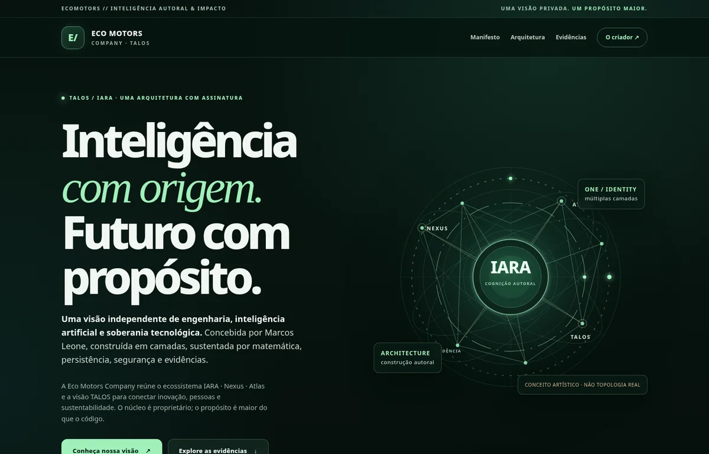
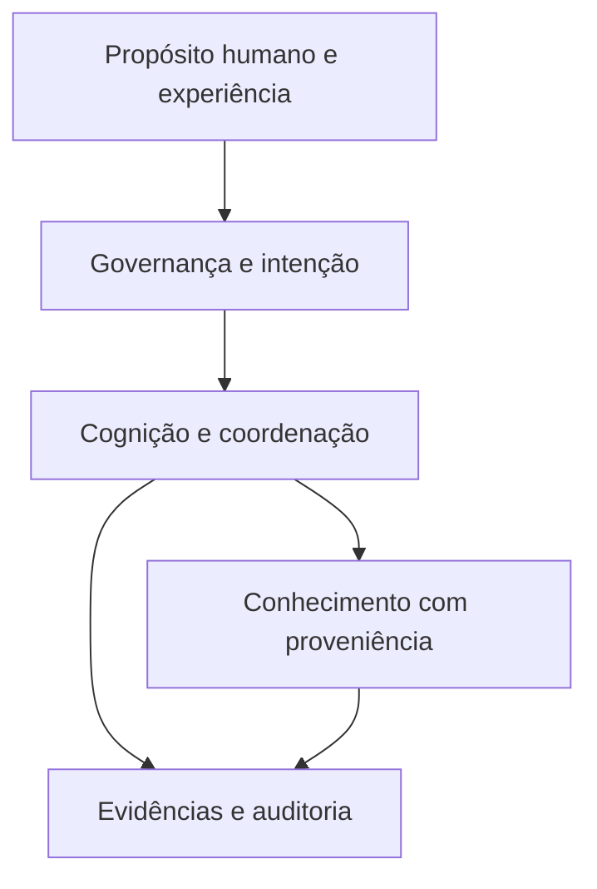

# ECO MOTORS COMPANY · TALOS / IARA

### Inteligência com origem. Futuro com propósito.

**Portfólio institucional e profissional de Marcos Leone** — criador e arquiteto principal da IARA e do ecossistema de engenharia da Eco Motors Company.

**Arquitetura autoral • IA aplicada • Segurança por desenho • Continuidade • Sustentabilidade**

> **Explore a experiência:** este repositório contém o portal estático em [`index.html`](index.html). Após a ativação do GitHub Pages, o endereço público aparecerá em **Settings → Pages**; ele deve ser conferido antes de compartilhado. A publicação não está presumida aqui.

---

## Nossa visão

A Eco Motors Company desenvolve um ecossistema original de inteligência e governança, conectado a uma visão de mobilidade responsável, rastreabilidade e economia circular. **IARA · Nexus · Atlas · TALOS** expressam diferentes responsabilidades de uma arquitetura concebida desde seus princípios, integrada progressivamente e validada por marcos técnicos.

Nossa interpretação de **privado** vai além de “código não publicado”: significa autoria, responsabilidade sobre o desenho, pesquisa própria, propriedade intelectual e custódia institucional de decisões, fontes e evidências. Frameworks e serviços de terceiros são reconhecidos como tecnologias integradas, não apresentados como invenções próprias.

O objetivo do portfólio é compartilhar o pensamento de engenharia, sem abrir o núcleo operacional.

## O manifesto

[Leia o Manifesto de Origem e Continuidade](MANIFESTO.md) — texto editorial desta edição pública.

**Não construímos apenas respostas. Construímos condições para que o conhecimento tenha origem, responsabilidade e futuro.**

A tecnologia ganha significado quando traduz uma necessidade humana em algo que pode ser explicado, testado, revisado e preservado. A jornada da Eco Motors combina matemática, engenharia de sistemas, inteligência artificial, governança e responsabilidade ambiental. O compromisso é evoluir com integridade: distinguir o que já foi observado daquilo que ainda é pesquisa, hipótese ou plano.

## A arquitetura, em alto nível

O diagrama é conceitual. Não representa servidores, endpoints, políticas privadas, credenciais ou a topologia física.

| Identidade | Papel público | Fronteira |
|---|---|---|
| **IARA** | Cognição, interpretação e continuidade contextual | Inferência não adquire automaticamente autoridade operacional |
| **Nexus** | Governança de intenção, capacidades e efeitos | Solicitação ≠ autorização de execução |
| **Atlas** | Conhecimento, memória, custódia e rastreabilidade | Registro persistente ≠ fato automaticamente homologado |
| **TALOS** | Visão integradora e experiência institucional | A interface pública não acessa o runtime privado |

**Tecnologias estudadas e integradas na trajetória do projeto:** Python, FastAPI, Redis, ChromaDB, Temporal, orquestração de LLMs, observabilidade, controle de acesso e fundamentos de integridade criptográfica. A presença de uma tecnologia não constitui certificação de seu desempenho.

## Segurança enterprise: princípios e resultados delimitados

A engenharia da IARA prioriza confiança explícita e controle de fronteiras: autenticação, separação entre o plano de inferência e o plano de execução, classificação de dados e gestão governada de egress. Em termos práticos, a arquitetura busca reduzir a possibilidade de que uma frase, uma resposta gerada ou uma tentativa não autorizada produza efeitos físicos.

Os registros internos demonstram testes de controles e incidentes tratados por gates, inclusive **HOLD, recuperação e comparação de contratos**. Não estamos afirmando resistência absoluta a ataques, auditoria externa ou certificação independente de Zero Trust. Material sensível e logs integrais não são disponibilizados neste repositório.

## Evidências de engenharia — novembro de 2026

| Marco | Resultado observado | Limite de comprovação |
|---|---|---|
| C3-S2 / B3-EXEC01-R3 | Instalação com promoção limitada, quiescência e boot: **PASS** | Escopo de implantação, não todas as capacidades futuras |
| Contrato da API | OpenAPI canônico integral idêntico antes e após a promoção | Não equivale a homologação funcional universal |
| Pós-instalação | Cinco arquivos verificados por SHA-256; serviço ativo e OpenAPI HTTP 200 | Janela determinada de auditoria |
| Dois turnos cognitivos reais | Respostas textuais locais, HTTP 200 e zero artefatos criados pelos respectivos turnos | Modo determinístico; leitura documental específica não comprovada |

**Performance — referência histórica interna:** materiais de engenharia registram **latência inferior a 120 ms em cenário específico de inferência**. Esse valor é mantido como indicador técnico relatado, **não como SLA, tempo de resposta geral ou benchmark independente**. Ainda são necessários metodologia pública, amostragem, percentis e condições de medição para uma declaração universal.

## Sustentabilidade: visão, não produto certificado

Nossa agenda de pesquisa inclui rastreabilidade ambiental, economia circular e conceitos associados ao **EcoPark**. São direções estratégicas, não anúncio de que uma certificação de créditos de carbono, um mercado tokenizado ou um produto ambiental estejam comercialmente operacionais. A publicação respeita os limites de prova e preserva planos internos.

## A trajetória do criador

Marcos Leone conecta experiência prática em diferentes camadas de engenharia:

- **Exército Brasileiro (2009–2017):** infraestrutura de TI, servidores Linux/Windows, redes, telecomunicações e disciplina operacional.
- **Triumph Motorcycles (2019–2024):** liderança técnica, diagnóstico eletrônico, processos de manutenção e resolução de problemas complexos.
- **IARA / Eco Motors Company (desde 2025):** concepção e integração de uma arquitetura independente de inteligência, governança e continuidade; formação acadêmica em Inteligência Artificial em andamento.

Esse percurso reúne entendimento de hardware, infraestrutura, operação e software — uma base útil para construir sistemas que precisam funcionar e ser explicados.

## O que está aberto ao público — e o que não está

Este repositório contém **apresentação institucional e código da vitrine estática**, não o código proprietário da IARA, seus modelos, documentação restrita, tokens, configurações de segurança, IPs, URLs privadas ou bancos de dados. A demonstração interativa usa **cenários fictícios**, identificados como tais. Não há login, API, rastreamento ou integração com produção.

## Continuidade

O portfólio não é uma página permanente e imutável: é um primeiro marco público de uma visão institucional em evolução. Novos trabalhos, cursos, estudos e resultados poderão integrar futuras versões sem misturar a propriedade intelectual da Eco Motors com projetos de terceiros.

**Contato institucional:** [contato.ecomotorscompany@gmail.com](mailto:contato.ecomotorscompany@gmail.com)

---

*Eco Motors Company · © 2026 · Marcos Leone. Código de aplicação, dados, marca, know-how e materiais internos não são licenciados por este repositório. O conteúdo da página estática é divulgado apenas nos termos aplicáveis à plataforma de hospedagem e aos direitos autorais vigentes.*
